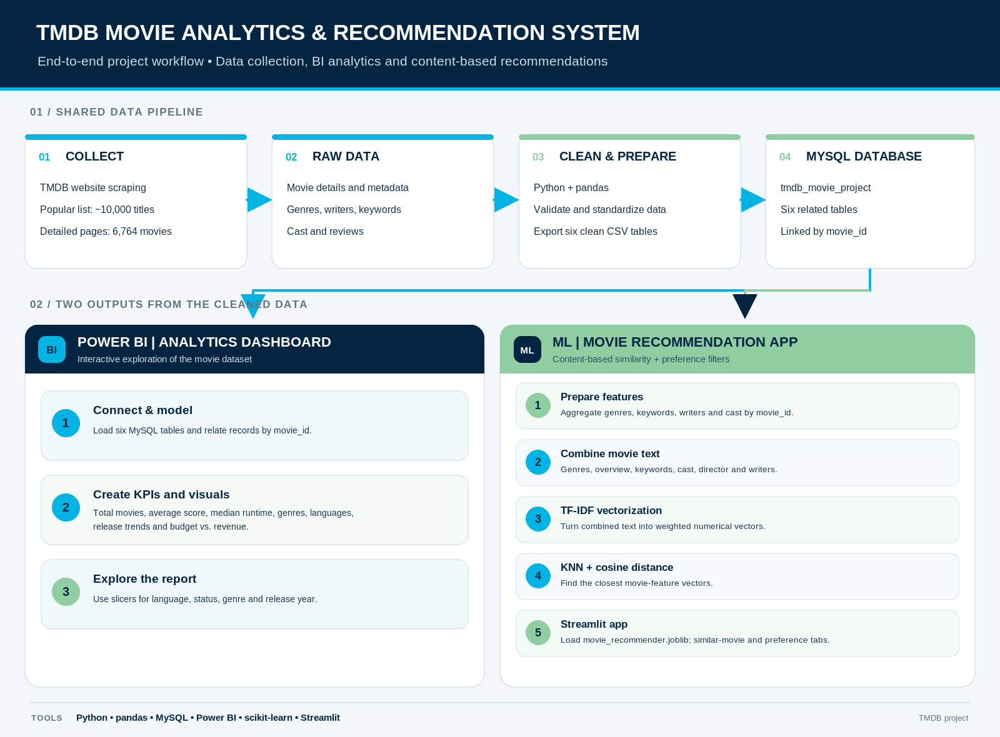
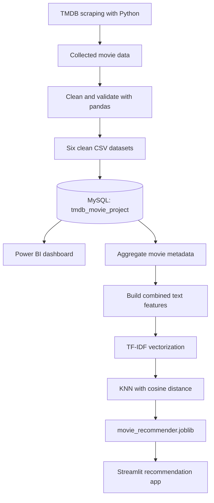

# TMDB Movie Analytics & Recommendation System

This is a project I built to explore movie data and make movie discovery a little easier. I collected movie information from TMDB, cleaned and organized it into related tables, explored the data in Power BI, and built a small Streamlit app that recommends similar movies.

## What the project does

- **Collects movie data:** Python scraping notebooks collect a popular-movie list and detailed movie information. Detailed pages were successfully collected for **6,764 movies**.
- **Cleans and organizes data:** The cleaned data is saved in six CSV files: movies, genres, writers, keywords, cast, and reviews.
- **Stores data in MySQL:** The tables are linked by `movie_id` in the `tmdb_movie_project` database.
- **Explores trends in Power BI:** The dashboard includes KPIs and visuals for genre distribution, average user score by genre, language, release-year trends, and budget versus revenue. Slicers make it possible to explore subsets of the data.
- **Recommends similar movies:** The model combines genre, overview, keywords, cast, director, and writers into text features. TF-IDF converts this text into vectors, and KNN with cosine distance finds similar movies.
- **Provides a Streamlit interface:** Users can find movies similar to a selected title or discover movies using genre, minimum rating, and maximum runtime filters.

## Project workflow





The **Power BI dashboard** and the **recommendation app** are two separate outputs built from the same cleaned movie data. The preference-discovery tab in the app uses filters; the similar-movie tab uses the TF-IDF/KNN model.

## Files

```text
TMDB-Movie-Analytics-Recommendation/
├── README.md
├── requirements.txt
├── app.py
├── movie_recommender.joblib
├── project_pipeline.png
├── project_pipeline.svg
├── TMDB ML.ipynb
├── TMDB Scraping.ipynb
├── TMDB Project.pbix
├── movies_table_clean.csv
├── movie_genres_clean.csv
├── movie_writers_clean.csv
├── movie_keywords_clean.csv
├── movie_cast_clean.csv
└── movie_reviews_clean.csv
```

- `app.py` is the Streamlit interface.
- `movie_recommender.joblib` contains the saved recommendation model and the movie data it needs. Keep it in the same folder as `app.py`.
- The two notebooks document the scraping and machine-learning work.
- `TMDB Project.pbix` is the Power BI report. If Windows hides file extensions, confirm the actual extension before using this name in the repository.
- The cleaned CSV files are included to document the data preparation and database tables.

## Run the Streamlit app

Use Python and run these commands from the project folder.

```bash
python -m venv .venv
```

On Windows, activate the environment with:

```powershell
.\.venv\Scripts\Activate.ps1
```

On macOS or Linux, use:

```bash
source .venv/bin/activate
```

Install the packages:

```bash
python -m pip install -r requirements.txt
```

Start the app:

```bash
python -m streamlit run app.py
```

The saved file `movie_recommender.joblib` must be next to `app.py`. The app uses this saved bundle, so you do not need to retrain the model just to launch the interface.

## Re-running the notebooks

The notebooks that read from MySQL expect a local MySQL server and a database named `tmdb_movie_project` with the project's tables. Set your own database credentials locally before running them. Do not commit passwords, API credentials, or `.env` files to GitHub. If the Power BI report uses a local database connection, update its data-source settings for your own environment.

## Notes

- The displayed similarity score is a content-similarity measure, not a probability or model-accuracy percentage.
- Movie recommendations depend on the metadata available in the collected dataset, so some results may be more relevant than others.
- This is an independent learning project and is not affiliated with or endorsed by TMDB.
